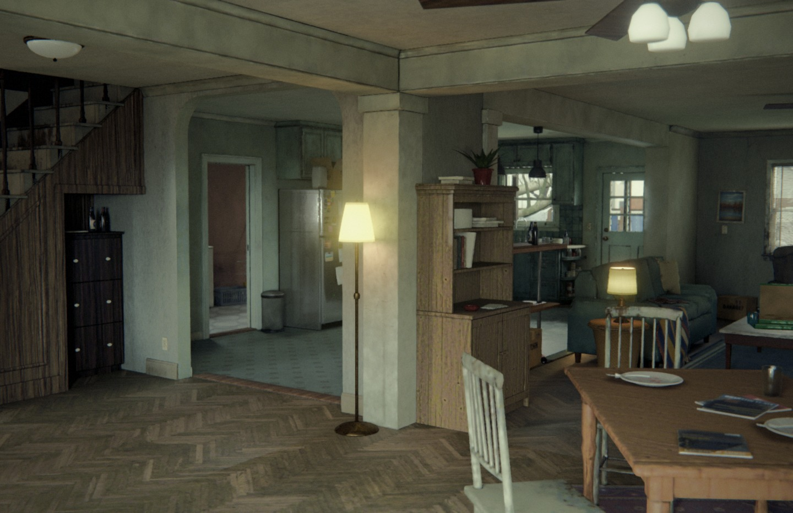
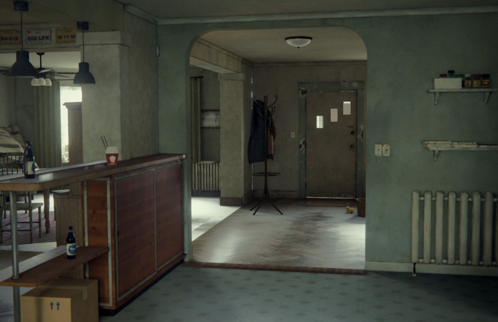
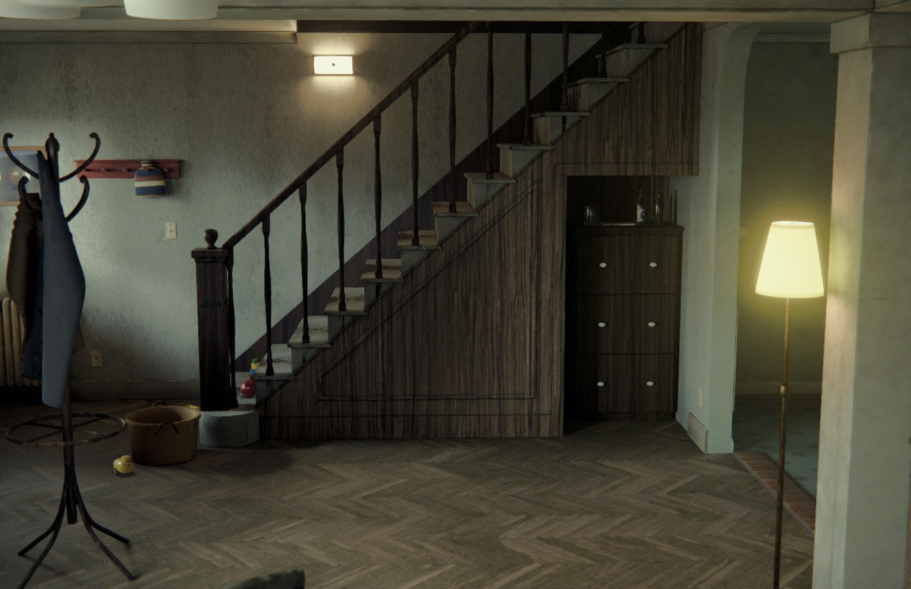
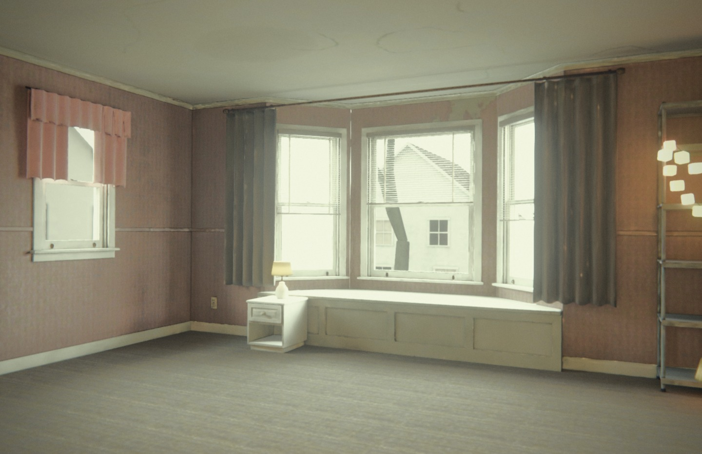
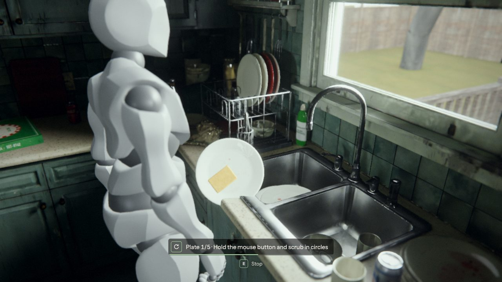

# Kara and Todd's House from Detroit: Become Human, Recreated in the Browser

This is an unofficial fan recreation of the house from the game's 'A New Home' chapter, made as a personal project with no commercial purpose. It contains no assets from the game and is not affiliated with Sony Interactive Entertainment or Quantic Dream. If a rights holder asks, I will take it down.

**Status: work in progress.** This repository holds screenshots only. The source code is private.

## What it is

A 3D model of the whole house that you can walk around in a web browser. You will play in third person as a new android designed for this project, who takes Kara's place and does the housework. Until that character is made, a grey placeholder figure stands in.

## How it is made

I am making this with AI. I set the direction, and AI coding agents in Claude Code do the building.

* Python scripts written by the AI build the whole house and everything in it inside Blender, a free 3D program.
* Blender works out the light of an overcast afternoon ahead of time and saves it into the textures.
* The house then loads into a web page with three.js, a free tool for showing 3D graphics in web pages. After each batch of changes, automated test runs walk through the house and check that the doors and chores still work.

Labels, book covers, framed pictures and the image on the TV are made by script.

## Where it is up to

* The whole house is built and lit: the kitchen, entry hall, living and dining room, laundry, the upstairs rooms, the back porch and the backyard.
* The ground floor is furnished and cluttered. The upstairs rooms are still mostly unfurnished.
* You can walk around, open doors and the fridge, switch on the kitchen light, pick up rubbish and wash the dishes.
* You can switch between two kinds of camera. One cuts between preset angles from area to area, like the original game. The other follows behind you.

## What comes next

* Rework parts of the entry hall, dining area and kitchen to match the original more closely.
* Furnish the upstairs rooms.
* Make the android character to replace the grey placeholder figure.
* Add the story, the remaining chores, animation and sound.

## More pictures

*The dining area, with the stairs on the left and the kitchen through the arch.*

*Looking from the kitchen through the arch into the entry hall.*

*The entry hall and the staircase.*

*An upstairs bedroom.*

*Washing up in an earlier build, with the grey placeholder figure.*

## Credits

* Textures: [Poly Haven](https://polyhaven.com/) and [ambientCG](https://ambientcg.com/), both CC0.
* Interface font: Instrument Sans (SIL Open Font License).
* Placeholder figure: Y Bot from [Mixamo](https://www.mixamo.com/).
