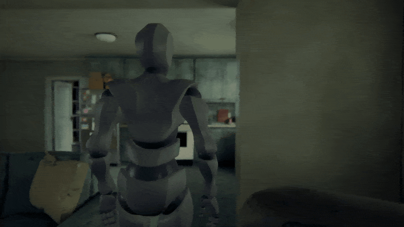

<a href="https://github.com/MoonMere/detroit-become-human-kara-todd-house"><kbd>English</kbd></a>

# 《底特律：变人》Kara 和 Todd 的房子浏览器复刻

这是游戏中“新家”一章里那栋房子的非官方同人复刻，作为个人项目制作，没有任何商业目的。它不包含游戏中的任何素材，与索尼互动娱乐、Quantic Dream 均无关联。如果权利人提出要求，我会把它撤下。

**状态：制作中。** 本仓库只有截图，源代码未公开。

*在浏览器里走过一楼，画面中是灰色的占位人物。*

## 这是什么

这是整栋房子的 3D 模型，可以在网页浏览器里走动。你将以第三人称操控一个为本项目设计的新仿生人，由它顶替 Kara 的位置来做家务。这个角色做出来之前，先由一个灰色的占位人物顶上。

## 我是怎么用 AI 来做的

所有代码都由 Claude Code 编写，包括在 Blender 里搭建房子的 Python 脚本，和让房子在浏览器里运行的 three.js 代码。我负责决定游戏要做成什么样，评判做出来的结果，并在做法行不通的时候换路。

* 之前的几版房子是用浏览器代码搭的。有一晚 AI 跑了七个小时，做出来的东西跟前一晚只跑一个小时的是一个水平。我追问它为什么不用 Blender，让它先在 Blender 里重做厨房的一个角落当小试验，交给另一个 AI 来评判。结果 Blender 明显胜出，我就让 AI 把整栋房子改用 Blender 重做。
* 我注意到客厅里茶几和电视之间的走道比原版游戏窄了很多，而 AI 自己的检查一直没有发现。之后我要求 AI 每次和原版对比都要量五样东西：格局、陈设、材质、光线和镜头构图。AI 照这条规矩把每个房间重新量了一遍，重新调整了整栋房子的格局。
* 仿生人的设定图是我用 AI 生图工具试了很多次才做出来的，从发型到衣服都是我挑的。AI 做的第一版头部花了六个小时，结果仍然很差，眼睛我只给 1 分（满分 10 分），于是我决定头部改用 Epic 的 MetaHuman 重做。
* 范围和底线是我定的。游戏做整整一章，包括二楼和后院，在我那台没有风扇的 MacBook Air 上要跑到每秒 30 帧以上。费功夫、拖帧率、玩家又感受不到的东西都可以砍掉，所以门前的街道只做成布景。
* AI 写的剧情草稿，我已经提了好几轮意见。比如我指出至少一半玩家玩过原作，所以不用把主角的身份藏得太深。我还要求照顾只想随便逛五分钟的玩家。

## 目前进度

* 整栋房子已经建好，光照也已做好，包括厨房、门厅、客厅和餐厅、洗衣房、楼上的房间、后门廊和后院。
* 一楼已经摆好家具，还堆放了杂物。楼上的房间大部分还没有家具。
* 可以走动、开门、开冰箱、开厨房的灯、捡垃圾、洗碗。
* 可以在两种镜头之间切换。一种和原版游戏一样，随着你从一个区域走到另一个区域，在预设的角度之间切换。另一种跟在你身后。

## 接下来

* 重做门厅、用餐区和厨房的一部分，让它们更贴近原版。
* 给楼上的房间布置家具。
* 制作仿生人角色，取代灰色的占位人物。
* 加入剧情、其余的家务、动画和声音。

## 更多图片

*由台灯照亮的客厅。*

*用餐区，左边是楼梯，穿过拱门是厨房。*

*从厨房穿过拱门望向门厅。*

*门厅和楼梯。*

*楼上的一间卧室。*

*早期版本里的洗碗场景，画面中是灰色的占位人物。*

## 致谢

* 贴图：[Poly Haven](https://polyhaven.com/)和[ambientCG](https://ambientcg.com/)，均为 CC0。
* 界面字体：Instrument Sans（SIL Open Font License）。
* 占位人物：来自[Mixamo](https://www.mixamo.com/)的 Y Bot。
